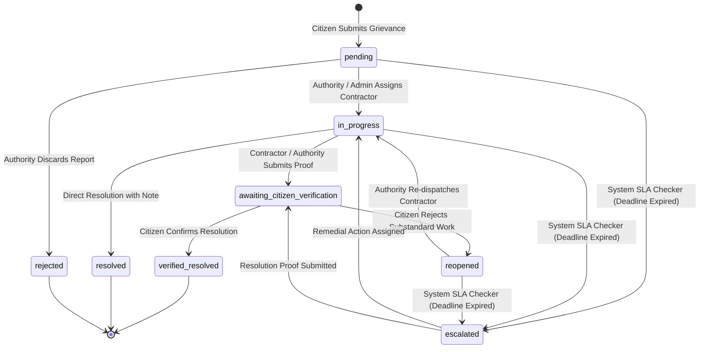
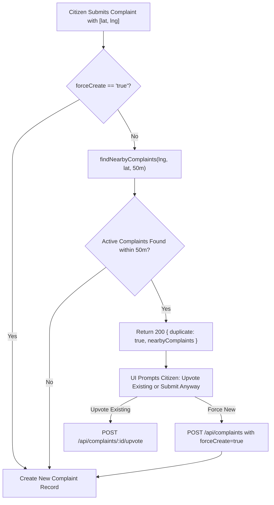

# NagarWatch Architecture Specification

This document provides a formal, comprehensive architectural specification of the critical algorithmic engines and state machines powering **NagarWatch**:
1. [The SLA State Machine & Lifecycle](#1-sla-state-machine--lifecycle)
2. [Explainable Ward Health Score Algorithm](#2-explainable-ward-health-score-algorithm)
3. [Geospatial Duplicate Detection Engine](#3-geospatial-duplicate-detection-engine)

---

## 1. SLA State Machine & Lifecycle

NagarWatch models civic grievances as a stateful, auditable lifecycle governed by statutory Citizens' Charter Service Level Agreements (SLAs).

### 1.1 Complaint States

The system defines 9 discrete states in `server/src/models/Complaint.ts`:

| State | Name | Description |
| :--- | :--- | :--- |
| `pending` | Pending Triage | Initial state upon citizen submission. Awaiting department assignment or contractor dispatch. |
| `in_progress` | Work In Progress | Assigned to a municipal authority or contractor. Field work is currently underway. |
| `resolution_submitted` | Resolution Submitted | Authority/contractor has performed the repair and submitted photographic proof. |
| `awaiting_citizen_verification`| Awaiting Verification | Proof has been attached; workflow is paused awaiting citizen inspection. |
| `verified_resolved` | Citizen Verified & Closed | Submitter has inspected before/after proof and confirmed satisfactory resolution. |
| `resolved` | Administratively Closed | Direct closure by an authority or administrator (with resolution proof/note). |
| `rejected` | Rejected | Discarded by authority (e.g., invalid jurisdiction, duplicate, or false report). |
| `escalated` | Escalated (SLA Breached) | Automatically or administratively escalated due to SLA timer expiration. |
| `reopened` | Reopened | Submitter rejected proof due to substandard or incomplete repair. |

---

### 1.2 State Transition Diagram



---

### 1.3 State Transitions & Authorization Matrix

| Initial State | Target State | Triggering Actor | API Endpoint / Method | Pre-conditions & Actions |
| :--- | :--- | :--- | :--- | :--- |
| `[*]` | `pending` | Citizen | `POST /api/complaints` | Image uploaded; title, description, category, address present; geo-duplicate check passed. SLA deadline computed. |
| `pending`, `reopened` | `in_progress` | Authority / Admin | `PATCH /api/complaints/:id/assign` or `PATCH /api/complaints/:id/status` | Work order linked to `contractorId` or `assignedTo`. Status history appended. |
| `pending`, `in_progress` | `rejected` | Authority / Admin | `PATCH /api/complaints/:id/status` | Rejection reason recorded in `statusHistory`. |
| `in_progress`, `pending` | `awaiting_citizen_verification` | Authority / Contractor | `POST /api/complaints/:id/resolution` | Mandatory `afterImage` proof uploaded. Verification initialized to `PENDING`. Real-time event `resolution_submitted` emitted. |
| `in_progress` | `resolved` | Authority / Admin | `POST /api/complaints/:id/resolve` | `resolutionNote` and optional `after` image provided. Notification sent to submitter. |
| `awaiting_citizen_verification`| `verified_resolved` | Citizen Submitter | `POST /api/complaints/:id/verify` | Submitter confirms satisfactory resolution. `verification.status = "VERIFIED"`. Contractor score updated. |
| `awaiting_citizen_verification`| `reopened` | Citizen Submitter | `POST /api/complaints/:id/reopen` | Submitter rejects resolution. `rejectionReason` mandatory. `verification.status = "REJECTED"`. Contractor score updated. |
| `pending`, `in_progress`, `reopened` | `escalated` | System SLA Checker / Admin | `checkAndEscalate()` worker | Clock time exceeds `sla.deadline`. `escalationLevel` incremented (up to 2). Notification and email dispatched. |

---

### 1.4 Statutory SLA Constants & Timing Logic

Defined in `server/src/services/slaService.ts`:

```typescript
const SLA_HOURS: Record<string, number> = {
  water: 24,       // High-priority water supply & pipeline leakage
  pothole: 72,     // Road pothole repair and surface patchwork
  garbage: 48,     // Solid municipal waste clearing and dump removal
  streetlight: 48, // Streetlight repair and electrical maintenance
  road: 72,        // Structural road hazards and resurfacing
  drainage: 48,    // Stormwater drain unblocking and flood mitigation
  other: 72,       // General civic grievances
};
```

#### SLA Calculation Formulas
- **Deadline Calculation**:
  $$\text{Deadline} = \text{Date.now}() + (\text{SLA\_HOURS}[\text{category}] \times 3600 \times 1000)$$
- **Early Warning Threshold (80% duration)**:
  $$\text{WarningDelay} = \text{SLA\_HOURS}[\text{category}] \times 0.8 \times 3600 \times 1000$$
- **Breach Delay (100% duration)**:
  $$\text{BreachDelay} = \text{SLA\_HOURS}[\text{category}] \times 1.0 \times 3600 \times 1000$$

#### Escalation Levels
When `Date.now() > complaint.sla.deadline` and `complaint.status !== "resolved"`:
1. **Level 0 $\rightarrow$ Level 1**: Escalated to Ward Supervising Engineer. Automated email and push notification dispatched.
2. **Level 1 $\rightarrow$ Level 2**: Escalated to Municipal Deputy Commissioner.
3. `sla.breached` flag set to `true`.

#### Section 6(1) Right to Information (RTI) Trigger
Under Section 6(1) of the Indian RTI Act 2005, public authorities are mandated to provide information and redress within 30 days. NagarWatch scans complaints where:
$$\text{Age} = \text{Date.now}() - \text{createdAt} \ge 30 \text{ days}$$
When this statutory threshold is crossed without resolution, NagarWatch auto-compiles an RTI Act petition containing the complaint ID, GPS coordinates, assigned authority details, and breach logs for instant download.

---

## 2. Explainable Ward Health Score Algorithm

Implemented in `server/src/services/analytics/wardHealth.service.ts`, the Ward Health Score is a deterministic, explainable metric normalized between $10$ and $100$ that measures municipal performance across any ward.

### 2.1 Formula & Weights

```typescript
export const DEFAULT_WARD_HEALTH_CONFIG: WardHealthConfig = {
  weights: {
    resolutionRate: 0.30,     // 30% — Proportion of complaints closed
    slaCompliance: 0.25,      // 25% — Complaints completed within SLA timer
    resolutionSpeed: 0.15,    // 15% — Mean turnaround time
    lowPendingRatio: 0.15,    // 15% — Active backlog control
    lowReopeningRatio: 0.10,  // 10% — Quality audit (citizen reopen rate)
    lowCriticalRatio: 0.05,   //  5% — Public safety hazard density
  },
};
```

$$\text{HealthScore} = \text{clamp}_{10}^{100}\left(\sum_{i} W_i \times S_i\right)$$

---

### 2.2 Sub-Score Formulations & Normalization

1. **Resolution Rate Score ($S_{\text{res}}$) — Weight: 0.30**
   $$\text{ResolutionRate} = \begin{cases} 100 & \text{if } N_{\text{total}} = 0 \\ \text{round}\left(\frac{N_{\text{resolved}}}{N_{\text{total}}} \times 100\right) & \text{if } N_{\text{total}} > 0 \end{cases}$$
   *(Where $N_{\text{resolved}}$ includes statuses `resolved` and `verified_resolved`)*.

2. **SLA Compliance Score ($S_{\text{sla}}$) — Weight: 0.25**
   $$\text{SLACompliance} = \begin{cases} 100 & \text{if } N_{\text{total}} = 0 \\ \max\left(0, \text{round}\left(\frac{N_{\text{total}} - N_{\text{breached}}}{N_{\text{total}}} \times 100\right)\right) & \text{if } N_{\text{total}} > 0 \end{cases}$$

3. **Resolution Speed Score ($S_{\text{speed}}$) — Weight: 0.15**
   - Let $\overline{H}$ be the average hours elapsed between `createdAt` and `resolvedAt` across resolved complaints (benchmark target: $\le 24$ hours).
   $$S_{\text{speed}} = \max\left(10, \min\left(100, \text{round}\left(100 - \frac{\overline{H}}{72} \times 40\right)\right)\right)$$
   - *Example values*:
     - $\overline{H} \le 24\text{h} \implies S_{\text{speed}} \approx 87 - 100$
     - $\overline{H} = 72\text{h} \implies S_{\text{speed}} = 60$
     - $\overline{H} = 168\text{h} \implies S_{\text{speed}} = 10 \text{ (clamped)}$

4. **Low Pending Ratio Score ($S_{\text{pending}}$) — Weight: 0.15**
   Measures backlog control against open tickets (`pending`, `resolution_submitted`, `awaiting_citizen_verification`):
   $$S_{\text{pending}} = \begin{cases} 100 & \text{if } N_{\text{total}} = 0 \\ \max\left(0, \text{round}\left(100 - \frac{N_{\text{pending}}}{N_{\text{total}}} \times 100\right)\right) & \text{if } N_{\text{total}} > 0 \end{cases}$$

5. **Low Reopening Ratio Score ($S_{\text{reopen}}$) — Weight: 0.10**
   Measures repair quality by penalizing complaints rejected and reopened by citizens ($5\times$ penalty multiplier):
   $$S_{\text{reopen}} = \begin{cases} 100 & \text{if } N_{\text{total}} = 0 \\ \max\left(0, \text{round}\left(100 - \frac{N_{\text{reopened}}}{N_{\text{total}}} \times 100 \times 5\right)\right) & \text{if } N_{\text{total}} > 0 \end{cases}$$

6. **Low Critical Ratio Score ($S_{\text{critical}}$) — Weight: 0.05**
   Penalizes presence of high-hazard critical priority issues ($2\times$ penalty multiplier):
   $$S_{\text{critical}} = \begin{cases} 100 & \text{if } N_{\text{total}} = 0 \\ \max\left(0, \text{round}\left(100 - \frac{N_{\text{critical}}}{N_{\text{total}}} \times 100 \times 2\right)\right) & \text{if } N_{\text{total}} > 0 \end{cases}$$

---

### 2.3 Diagnostic Explainability Engine

Rather than displaying an opaque score, the system generates diagnostic insights for municipal administrators:

| Metric Condition | Classification | Human-Readable Feedback Generated |
| :--- | :--- | :--- |
| $\text{ResolutionRate} \ge 75\%$ | Positive | `Strong Resolution Rate: X% of issues resolved` |
| $\text{ResolutionRate} < 75\%$ | Needs Attention | `Low Resolution Rate: Only X% resolved` |
| $\text{SLACompliance} \ge 80\%$ | Positive | `High SLA Compliance: X% completed within charter deadline` |
| $\text{SLACompliance} < 80\%$ | Needs Attention | `SLA Breaches: X overdue complaints (Y% compliance)` |
| $\overline{H} \le 36\text{h}$ | Positive | `Rapid Response: Average turnaround of X hours` |
| $\overline{H} > 36\text{h}$ | Needs Attention | `Slow Turnaround: Average resolution takes X hours` |
| $N_{\text{pending}} > 15$ | Needs Attention | `Backlog Pressure: X pending grievances awaiting triage` |
| $N_{\text{critical}} > 0$ | Needs Attention | `Hazard Alerts: X critical priority issues open` |
| $N_{\text{reopened}} > 0$ | Needs Attention | `Quality Verification: X complaints reopened by citizens` |

---

## 3. Geospatial Duplicate Detection Engine

Implemented in `server/src/services/geoService.ts` and `server/src/routes/complaints.ts`, this engine prevents flood reporting of identical physical hazards (e.g., multiple commuters reporting the same pothole).

### 3.1 Spatial Indexing & Parameters

- **Geometry**: GeoJSON `Point` (`coordinates: [longitude, latitude]`).
- **Index**: MongoDB 2dsphere index on `location.coordinates`:
  ```typescript
  ComplaintSchema.index({ "location.coordinates": "2dsphere" });
  ```
- **Radius Threshold**: $50\text{ meters}$ (`maxDistance = 50`).
- **Spherical Calculation**: `spherical: true` (calculates true geodesic distances over the WGS84 ellipsoid).

---

### 3.2 Aggregation Pipeline

```typescript
export async function findNearbyComplaints(
  lng: number,
  lat: number,
  radiusMeters = 50
): Promise<NearbyComplaint[]> {
  return Complaint.aggregate<NearbyComplaint>([
    {
      $geoNear: {
        near: { type: "Point", coordinates: [lng, lat] },
        distanceField: "distance",
        maxDistance: radiusMeters,
        spherical: true,
        query: { status: { $ne: "resolved" } },
      },
    },
    { $limit: 5 },
  ]);
}
```

### 3.3 Flow Logic & User Override



1. **Resolution Exclusion**: Only complaints where `status !== "resolved"` are evaluated. Resolved issues allow new complaints (e.g., if a pothole re-appears).
2. **Citizen Upvote Option**: Instead of creating a duplicate ticket that scatters authority attention, the citizen is prompted to upvote the existing active complaint, boosting its `priorityScore` and visibility on the civic heatmap.
3. **Explicit Override**: Citizens can bypass the filter by passing `forceCreate: "true"` if they are reporting a distinct issue located in close proximity (e.g., a broken streetlight next to an existing pothole).
